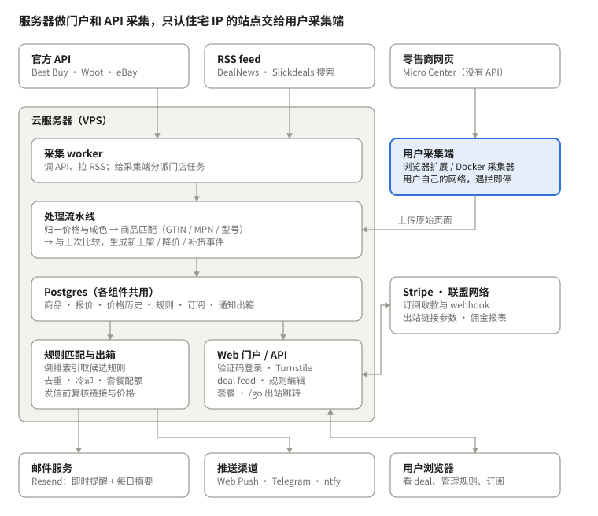

# DealSeaking

美国电子产品 deal 监控门户：用户注册后按品类、型号、价格等规则订阅，新上架、降价、补货、open box 出现时收到邮件或推送。开放注册，计划商业化（联盟佣金 + Pro 订阅）。

> 状态：设计阶段。实现将从 openbox-monitor（Micro Center / Best Buy open box 监控）重构而来。

## 文档

| 文档 | 内容 |
| --- | --- |
| [docs/design.md](docs/design.md) | 功能设计与技术方案：功能清单、商业模式、规则模型、页面、架构、流水线、存储、数据源评估、邮件、合规、路线图 |
| [docs/decisions.md](docs/decisions.md) | 决策记录（商业化、开放注册、技术栈、架构、数据源原则） |
| [docs/architecture.svg](docs/architecture.svg) | 系统架构图 |
| [docs/rule.schema.json](docs/rule.schema.json) | 监控规则的 JSON Schema，示例见 [docs/examples/rule-ssd.json](docs/examples/rule-ssd.json) |
| [docs/schema.sql](docs/schema.sql) | Postgres 表结构草案 |

## 计划技术栈

- Python：FastAPI + SQLAlchemy，Dramatiq 或 Postgres 队列
- Postgres 16
- 前端：Jinja + htmx（服务端渲染）
- 邮件：Resend；收款：Stripe；注册防机器人：Cloudflare Turnstile
- 部署：单台 VPS（Docker Compose），加一个家用采集节点

## 路线

1. 把 openbox-monitor 重构成 source adapter + 公共流水线，换成 Postgres
2. 接 Best Buy API、Woot API、DealNews RSS，并做跨来源的商品匹配
3. 门户 MVP：登录、deal feed、规则、每日摘要、退订
4. 商业化：Free / Pro 套餐、Stripe、联盟链接、条款与披露
5. 公开上线，扩展数据源和推送渠道

详见 [docs/design.md#实施路线](docs/design.md#实施路线)。

## 版权

Copyright © 2026 Kelvin Yang. All rights reserved. 未授权不得复制、分发或用于商业目的。
