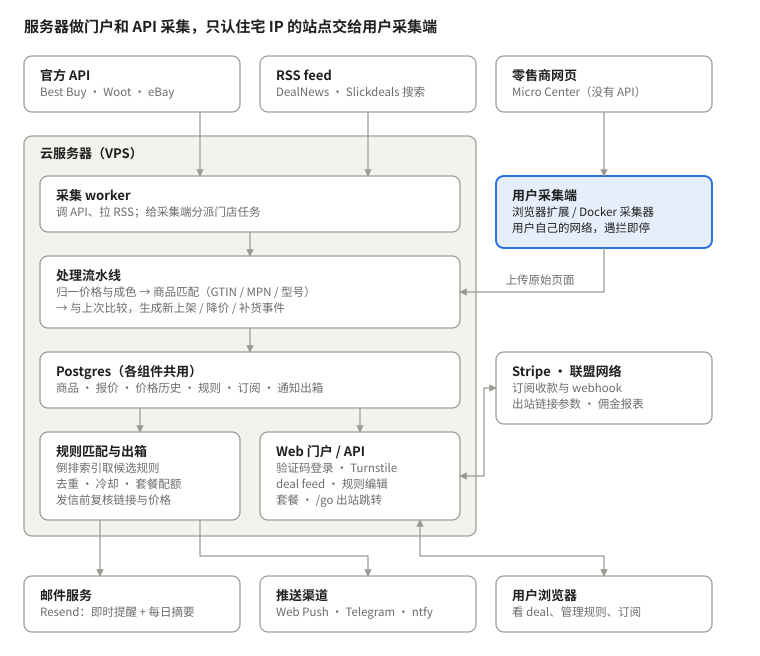

# DealSeaking：功能设计与技术方案

> 状态：设计稿 v0.2 · 更新于 2026-11-17 · 由 openbox-monitor（Micro Center / Best Buy open box 监控）演进而来

DealSeaking 是一个面向美国市场的电子产品 deal 监控门户：**开放注册、计划商业化**。用户按品类、型号、价格等规则订阅，命中后收到邮件或推送。

几个关键约束：
- **数据：** 以官方 API 和明确允许转载的公开 feed 为主，少量低频网页抓取为辅。
- **技术栈：** 后端 Python + Postgres，邮件用 Resend，收费用 Stripe。
- **成本：** 公开上线后固定成本约每月 30–40 美元。
- **外部限制：**
  - Amazon、Walmart、Target、Costco 只能走官方、联盟或付费渠道。
  - Reddit 的公开 RSS 已于 2026-11-13 停止。
  - 商业化后，数据源条款和邮件法规的要求都按商业用途算。

已做的决定和理由见 [decisions.md](decisions.md)。

## 目录

1. [功能清单](#功能清单)
2. [商业模式与开放注册](#商业模式与开放注册)
3. [监控规则模型](#监控规则模型)
4. [门户页面](#门户页面)
5. [系统架构](#系统架构)
6. [数据流水线](#数据流水线)
7. [数据存储](#数据存储)
8. [数据源评估](#数据源评估)
9. [邮件与推送](#邮件与推送)
10. [注册验证与链接校验](#注册验证与链接校验)
11. [可复用的开源项目与工具](#可复用的开源项目与工具)
12. [托管与成本估算](#托管与成本估算)
13. [合规与风险](#合规与风险)
14. [实施路线](#实施路线)
15. [待定问题](#待定问题)
16. [Sources](#sources)

## 功能清单

MVP 只做“浏览 + 规则 + 邮件提醒 + 免费 / 付费两档”，并把现有 Micro Center / Best Buy 抓取迁移进来；跨店比价、更多渠道放到后面。

| 模块 | MVP | V1 | V2 |
| --- | --- | --- | --- |
| 账户 | 邮箱 OTP / magic link 登录，邮箱验证（double opt-in），时区与静默时段，注册防机器人 | Google 登录，ZIP + 半径选门店，默认通知渠道 | 团队或家庭共享规则 |
| 付费 | Free / Pro 两档，Stripe Checkout 订阅，Customer Portal 自助管理 | 年付、优惠码 | 团队套餐 |
| Deal 浏览 | 统一 feed；按分类、品牌、价格、折扣、来源、成色（新品 / open box / 翻新）筛选和排序 | 商品详情页：价格走势、跨店比价、历史最低标记 | 热度排序 |
| 监控规则 | 品类、关键词（含排除词）、型号、价格上限、折扣下限；事件：新上架、降价、补货；按套餐限制规则数 | 粘贴商品链接直接跟踪；单位价（如每 TB 价格）；门店距离；历史新低 | 规则模板、一键订阅热门规则 |
| 通知 | 邮件即时提醒（Pro）+ 每日摘要（所有人），一键退订 | Web Push（PWA）、Telegram、Discord、ntfy | 每周摘要、App 推送 |
| 数据源 | Best Buy API、Woot API、DealNews RSS；Micro Center（见[待定问题](#待定问题)）；Slickdeals 搜索 RSS 只用于规则匹配，未获授权前不在门户展示 | eBay Browse API、Walmart Affiliate API、Amazon（路线见[待定问题](#待定问题)） | 联盟网络商品 feed（Impact、CJ、Rakuten） |
| 变现 | 出站链接统一走跳转服务（记录点击，按来源加联盟参数），页面和邮件披露 | 联盟收入报表 | 精选 deal 位 |
| 链接与质量 | 发信前重新校验链接与库存，过期 deal 自动下架；用户提交链接过 Web Risk | 失效自动重试、用户举报 | — |
| 管理后台 | 数据源健康度、抓取失败率、队列积压、注册与发信量 | 退信 / 投诉监控、手动合并重复商品、订阅与收入 | 运营数据看板 |

## 商业模式与开放注册

收入来自两块：出站链接的联盟佣金和 Pro 订阅。开放注册意味着从第一天起就要防滥用、控制发信量，并备齐服务条款、隐私政策和联盟披露。

### 收入来源

| 来源 | 机制 | 说明 |
| --- | --- | --- |
| 联盟佣金 | 用户点 deal 时经 `/go/<id>` 跳转，按零售商加上联盟参数 | Amazon Associates 电脑配件类约 2.5%、耳机 3%；申请后 180 天内要有 3 笔合格销售，否则作废（[来源](https://gauravtiwari.org/amazon-affiliate-program/)）。Walmart、Target 走 Impact，Dell 走 CJ，Newegg 走 Rakuten，都要求有网站并逐个申请。Micro Center 没有联盟计划 |
| Pro 订阅 | Stripe Checkout + Billing，按月 / 按年 | Stripe 美国卡 2.9% + 30 美分每笔，Billing 另收 0.7%（[来源](https://stripe.com/pricing)） |

DealNews 的 feed 要求保留它自己的推荐链接，这部分没有我们的佣金；Best Buy API 的数据须注明来源并链接回 Best Buy。

### 套餐草案（价格待定）

| | Free | Pro |
| --- | --- | --- |
| 规则数 | 3 | 50 |
| 邮件 | 每日摘要 | 即时提醒 + 摘要 |
| 推送渠道 | — | Web Push、Telegram、Discord、ntfy |
| 价格历史 | 30 天 | 完整 |
| 门店范围 | 1 个 ZIP | 多个 ZIP |

把即时提醒放在 Pro，好处是免费用户的发信量可控（每人每天最多一封摘要），发信成本和投诉风险都跟着收入走。

### 开放注册的防滥用

- **注册和登录：** 表单加 [Cloudflare Turnstile](https://developers.cloudflare.com/turnstile/plans/)（免费、无限次验证，不要求站点托管在 Cloudflare）。按 IP 和邮箱限速，拦一次性邮箱，检查 MX 记录。
- **配额：** 规则数、每日邮件数、用户提交链接数都按套餐设上限，超出时提示升级，不静默丢弃。
- **抑制名单：** 退订、退信、投诉的邮箱自动停发；账户删除后仍保留哈希，确保不会再发。
- **成本上限：** 发信服务设每日硬上限；出现异常注册潮时自动收紧限速。

### 上线前的法务与运营准备

- [ ] 成立 LLC（各州费用不同），开商业银行账户，Stripe 和联盟收款都用公司名义
- [ ] 服务条款（含面向成年人、禁止自动化抓取本站、免责声明）和隐私政策（收集什么、用了哪些服务商、保存多久、怎么删除）
- [ ] 联盟披露：网站页脚、每个 deal 链接旁、每封提醒邮件都要有（FTC 要求清楚、靠近链接）
- [ ] 邮件页脚写实际通信地址，可用虚拟地址或注册代理地址（CAN-SPAM）
- [ ] 逐个确认数据源条款允许商业展示（见[数据源评估](#数据源评估)）

## 监控规则模型

一条规则 = 监控对象 + 筛选条件 + 触发事件 + 投递方式。页面上用表单搭规则，存储和执行用同一份 JSON，以后加条件不用改表结构。完整定义见 [rule.schema.json](rule.schema.json)。

| 部分 | 可选项 |
| --- | --- |
| 监控对象 | 品类（统一分类树上的节点）；型号：精确（UPC/GTIN、品牌 + MPN、零售商 SKU）或模糊（关键词 + 排除词 + 正则）；品牌；某个商品链接 |
| 筛选条件 | 价格上限、折扣下限、低于历史最低、单位价（每 TB、每 GB 价格）、成色、来源、线上或门店（含距离）、是否有货 |
| 触发事件 | 新上架、降价（可设最小幅度）、补货、open box 出现、历史新低、社区热度超过阈值 |
| 投递方式 | 即时 / 每日摘要 / 每周摘要；渠道（邮件、Web Push、Telegram 等）；静默时段；冷却时间（同一件商品 N 小时内不重复提醒）；每天上限 |

示例：监控 4TB 以上的 NVMe SSD，每 TB 低于 70 美元或创历史新低时即时发邮件，其余变化放进每日摘要（[examples/rule-ssd.json](examples/rule-ssd.json)）。

```json
{
  "name": "4TB+ NVMe SSD low price",
  "target": {"category": "storage/ssd/nvme", "keywords_exclude": ["heatsink only", "enclosure"]},
  "conditions": {
    "min_capacity_gb": 4000,
    "any": [{"max_price_per_tb": 70}, {"historical_low": true}],
    "conditions_allowed": ["new", "open_box"],
    "sources": ["microcenter", "bestbuy", "woot"],
    "store_radius_miles": 30
  },
  "events": ["new", "price_drop", "restock"],
  "delivery": {"mode": "instant", "channels": ["email"], "cooldown_hours": 24,
               "quiet_hours": ["23:00", "08:00"], "else": "daily_digest"}
}
```

规则变多后，不能拿每条新 deal 跟每条规则逐一比对。做法是按品类、品牌和型号 token 建倒排索引，先取出候选规则，再逐条判断价格等条件。

## 门户页面

九个页面覆盖 MVP；未登录用户能看 deal feed，创建规则时再要求注册。

| 页面 | 内容 |
| --- | --- |
| 首页 / Deal feed | 实时 deal 列表，筛选栏，“为这个筛选建规则”按钮（把当前筛选直接转成规则） |
| 商品详情 | 各来源报价、成色、价格走势、历史最低、“监控这个型号”按钮 |
| 搜索 | 型号、品牌、UPC 搜索，结果可一键建规则 |
| 我的规则 | 规则列表（启用 / 暂停、最近命中、本周提醒数），新建 / 编辑表单，实时预览“过去 7 天会命中哪些 deal”，显示套餐剩余规则数 |
| 通知中心 | 已发提醒的历史记录，点击跟踪，“不再提醒这件商品” |
| 设置 | 邮箱、时区、ZIP 与半径、静默时段、渠道绑定（Telegram、Web Push）、摘要时间、删除账户 |
| 套餐与账单 | Free / Pro 对比，升级（Stripe Checkout），管理订阅（Stripe Customer Portal） |
| 登录 / 注册 | 输入邮箱收 6 位验证码或登录链接，无密码；Turnstile 验证 |
| 管理后台 | 数据源状态、最近失败、队列积压、邮件退信与投诉率、重复商品合并、注册与订阅数 |

另有条款、隐私政策、联盟披露三个静态页。“实时预览”对用户最有用：规则写宽了会一天收几十封，写窄了什么都收不到，保存前就能看到。

## 系统架构

一台服务器跑门户、数据库和走 API / RSS 的采集；只认住宅 IP 的站点（目前是 Micro Center）由家里现有的容器抓，结果用 HTTPS 推给服务器。



这样服务器的机房 IP 不碰容易被拦的站点，家里的节点也不用对外开放端口。商业化后新增两个外部依赖：Stripe（订阅与 webhook）和联盟网络（出站链接参数、佣金报表），都只和门户 / API 交互。

## 数据流水线

每个数据源写成一个 adapter，只负责“取回来并解析成统一格式”；之后的步骤所有来源共用。现有的 Micro Center 和 Best Buy 代码就是前两个 adapter。

1. 调度：每个来源按自己的频率和配额入队（例如 Best Buy API 每秒 5 次、Woot 每天 1,000 次），队列按域名限速。
2. 抓取：adapter 调 API 或 RSS，网页类来源优先读页面里的 schema.org JSON-LD（Product / Offer）。原始响应短期留存，方便排查。
3. 解析与归一：统一成 offer（来源、SKU、标题、价格、原价、成色、门店、库存、链接），价格用 price-parser 转数字。
4. 商品匹配：把 offer 归到同一个商品上。优先级：GTIN/UPC → 品牌 + MPN → 标题里的型号正则 → 模糊匹配（可加 LLM 判定）。不确定的进后台待审。
5. 差异检测：跟上次观测比较，生成事件（新上架、降价、涨价、补货、下架、历史新低）。沿用现在的做法：抓取失败不判“下架”，新来源第一轮只记基线。
6. 规则匹配：用倒排索引取候选规则，逐条判断，命中写入 rule_matches。
7. 通知出箱：写 outbox，按 dedupe key（用户 + 商品 + 事件）去重，应用冷却时间、静默时段和套餐配额；摘要类放到定时任务里合并。
8. 发送前复核：即时提醒先重新检查一次链接和价格，已失效就不发。
9. 发送与回流：调邮件或推送服务；通过 webhook 收退信和投诉，自动停发并加入抑制名单。出站点击经 `/go/<id>` 记录。

## 数据存储

一个 Postgres 就够到几千用户：业务表、价格时间序列、任务队列都放在里面；价格观测表按月分区，数据量大了再上 TimescaleDB。表结构草案见 [schema.sql](schema.sql)。

| 表 | 内容 | 备注 |
| --- | --- | --- |
| users / auth_tokens | 邮箱、验证状态、时区、ZIP；登录令牌只存哈希 | 未验证账户 7 天后清理 |
| plans / subscriptions | 套餐配额；Stripe customer / subscription id、状态、到期时间 | 状态以 Stripe webhook 为准 |
| sources / stores | 数据源配置、配额、状态、条款备注；门店坐标 | 现有 Micro Center 门店表直接迁移 |
| categories | 统一分类树 + 各来源分类的映射 | 例如 MC「SSD (Solid State Drives)」→ storage/ssd |
| products | 规范化商品：品牌、型号、MPN、GTIN、分类、属性（jsonb，如容量） | GTIN 和品牌 + MPN 建唯一索引 |
| offers | 某来源的某个报价：来源 SKU、商品、链接、成色、门店、当前价、是否在架 | 即现在的 listings 表 |
| price_points | offer + 时间 + 价格 + 库存 | 按月分区；Best Buy API 数据按条款只留 72 小时 |
| deal_events | 新上架、降价等事件，含旧价、新价、热度分 | 首页 feed 的数据来源 |
| rules / rule_matches | 用户规则（JSON）、命中记录 | 倒排索引存成一张辅助表 |
| notifications | 出箱：用户、渠道、状态、dedupe key、发送时间 | 重试和去重都靠这张表 |
| email_suppressions | 退订、退信、投诉的邮箱（存哈希） | 删除账户后也保留，确保不再发 |
| link_checks | 链接、HTTP 状态、库存状态、安全检查结果、检查时间 | 发信前复核时读写 |
| outbound_clicks | 用户（可空）、offer、时间、来源渠道（网页 / 邮件） | 联盟收入对账 |

其他存储：Redis 做队列和短期缓存（也可以不用，直接用 Postgres 队列）；原始页面快照放对象存储或本地磁盘，留 7 天；搜索先用 Postgres 全文检索和 pg_trgm，商品过 10 万再考虑 Meilisearch。

## 数据源评估

能免费、合规拿到的只有 Best Buy、Woot、eBay 三家的官方 API 和 DealNews 等公开 feed；Amazon 要么付费用 Keepa，要么先做出联盟销量。商业化后，“能不能在付费产品里展示”比“能不能拿到”更关键。

### 官方 API 与付费数据

| 来源 | 费用 | 门槛 | 能拿到的数据 | 商业化备注 |
| --- | --- | --- | --- | --- |
| [Best Buy API](https://developer.bestbuy.com/legal) | 免费 | 非免费邮箱注册（已申请，审核中） | 价格、线上库存、各门店是否有货、线上 open box（excellent / certified） | 每秒 5 次、每天 5 万次；缓存不超过 72 小时；须注明来源并链接回 Best Buy；不得用来给其他零售商做价格分析 |
| [Woot API](https://developer.woot.com/) | 免费 | 在 Woot 论坛申请 key | 价格、是否售罄、成色、起止时间 | 每天 1,000 次；页面没有正式条款，商用前写信确认 |
| [eBay Browse API](https://developer.ebay.com/develop/api/buy/api_call_limits) | 免费 | 开发者账号；2026 年起有注册被拒的报告 | 价格、成色、库存状态 | 每天 5,000 次；只用一口价商品，不得重新排序 |
| [Walmart Affiliate API](https://walmart.io/apidocs/affiliates/quickstart) | 免费 | 需在 Impact 上加入 Walmart 联盟并获批 | 价格、库存、门店 | 链接须带联盟 ID |
| [Amazon Creators API](https://affiliate-program.amazon.com/creatorsapi/docs/en-us/paapiv5-deprecation) | 免费 | Associates 账号，且近 30 天至少 10 笔合格销售 | 主推报价、折扣、Lightning deal | 起步拿不到；旧的 PA-API 5 已于 2026 年 5 月停用 |
| [Keepa API](https://keepa.com/api-docs/) | 起价 49 欧元/月 | 付费即可 | Amazon 价格历史、deal 列表 | 能拿到数据，但按 Amazon 政策，用它展示价格就不能挂 Amazon 联盟链接 |
| [SerpApi](https://serpapi.com/pricing) | 每月 250 次免费 | 无 | Google Shopping 里的跨零售商报价 | 本质是抓 Google，商用有条款风险 |
| [Impact](https://help.impact.com/partner/what-would-you-like-to-learn-about/platform-features/marketing-content/product-marketplace-and-catalogs/download-product-catalogs-as-a-partner) / CJ / Rakuten 商品 feed | 免费 | 需有网站并逐个品牌申请 | 商品目录、价格（每日同步） | 开放注册的门户本身就是申请所需的网站 |
| Micro Center | — | 无 API、无联盟计划 | — | 见[待定问题](#待定问题) |

### Deal 聚合 feed

| 来源 | 方式 | 状态 | 转载条款 |
| --- | --- | --- | --- |
| [DealNews](https://www.dealnews.com/rss.html) | 官方 RSS：最新、热门、编辑精选、分类 | 可用 | 允许使用，需注明来源、不得改动推荐链接。是条款最宽松的一家 |
| [Slickdeals](https://corp-site.slickdeals.net/?p=351) | 搜索 RSS（newsearch.php 加 rss=1） | 可用；2025 年有用户报告结果偶尔跑题 | 禁止未经许可的自动访问和在其他网站或 App 展示其 offer。只用于内部规则匹配，展示需授权 |
| 9to5Toys | WordPress 的 /feed/ | 应该可用（未验证） | 编辑内容，只做链接 |
| [Reddit](https://www.techrepublic.com/article/news-reddit-rss-public-api-shutdown/)（r/buildapcsales 等） | RSS / API | RSS 于 2026-11-13 停止；公开 Data API 2027 年 3 月关闭 | 不作为数据源 |
| Kinja Deals | — | 已停运 | — |
| Ben's Bargains、Brad's Deals、TechBargains | 未找到官方 RSS | — | — |
| Discord / Telegram deal 频道 | 需管理员邀请 bot，或用个人账号客户端读取 | 灰色地带 | 不做 |

### 直接抓取的难度

| 零售商 | 反爬 | 难度 | 建议 |
| --- | --- | --- | --- |
| Micro Center | Cloudflare（零星 403） | 中；家用 IP + Safari 指纹已验证可用 | 由家用采集节点低频抓 |
| Best Buy | Akamai；robots.txt 禁止 | 搜索页可读，商品页会断开连接 | 改用 API |
| Newegg | Cloudflare（未验证） | 中 | 走联盟 feed |
| B&H | PerimeterX（未验证） | 中高 | 走联盟 |
| Target | Akamai + Cloudflare，行为评分 | 高 | 不做 |
| Walmart | Akamai + HUMAN，机房 IP 基本被拦 | 很高 | 用 Affiliate API |
| Costco | Akamai | 高 | 不做 |
| Amazon | 自研限流 | 高 | Keepa 或 Creators API |

难度评估主要来自 [ScrapeOps](https://scrapeops.io/websites/walmart/) 等第三方整理，标“未验证”的没找到可靠来源。原则：不绕过任何反爬或验证码，不用住宅代理。

## 邮件与推送

开放注册后每日摘要的量很快会超过免费档，所以公开上线时直接用 Resend Pro（20 美元/月，5 万封），量再大换 Amazon SES。不自建邮件服务器：VPS 的 IP 常在黑名单里，送达率保证不了。

| 服务商 | 免费额度 | 付费起步 | 备注 |
| --- | --- | --- | --- |
| [Resend](https://resend.com/docs/knowledge-base/what-is-resend-pricing.md) | 每月 3,000 封，每天 100 封 | 20 美元/月，5 万封 | 开发期用免费档，上线用 Pro |
| [Mailjet](https://www.mailjet.com/pricing/) | 每月 6,000 封，每天 200 封（带 Mailjet 标志） | 9 美元/月，8,000 封 | 备选 |
| [Brevo](https://www.brevo.com/pricing/) | 每天 300 封 | — | 账号需审核 |
| [Amazon SES](https://aws.amazon.com/blogs/messaging-and-targeting/introducing-amazon-simple-email-service-ses-pricing-plans/) | 2026-07-21 起新客户没有 SES 免费额度 | 按量计费 | 量大时最便宜；需申请生产权限 |
| [Cloudflare Email Service](https://developers.cloudflare.com/email-service/platform/pricing/) | 免费版只能发给自己验证过的地址 | Workers Paid（约 5 美元/月）含每月 3,000 封 | 2026 年 4 月起公测 |
| [Postmark](https://postmarkapp.com/pricing) | 每月 100 封 | 15 美元/月，1 万封 | 提醒类邮件要走其 broadcast 通道 |
| [SendGrid](https://www.twilio.com/en-us/changelog/changes-coming-to-sendgrid-s-free-plans) | 2025 年取消免费档 | 仅付费 | 不推荐 |

第一封邮件发出前要做完的事（Gmail / Yahoo 发信规则加 CAN-SPAM）：

- [ ] 用子域名发信（如 `alerts.<domain>`），配好 SPF、DKIM、DMARC（先 `p=none` 并收报告）
- [ ] 一键退订：邮件头带 `List-Unsubscribe` 和 `List-Unsubscribe-Post`（RFC 8058），正文也有退订链接，2 天内生效
- [ ] 投诉率控制在 0.1% 以下，绝不超过 0.3%；退信和投诉自动加入抑制名单
- [ ] 页脚写实际通信地址；带联盟链接时在链接旁标注
- [ ] Double opt-in：注册后先发确认邮件，点击后才开始发提醒

Deal 提醒在 CAN-SPAM 里算商业邮件（带联盟链接时更是），注册确认邮件算事务邮件。Google 从 2025 年 11 月起对不合规邮件直接延迟或拒收，所以量小也要按批量发信者的标准来。

其他推送渠道都免费：Web Push（iOS 16.4 以上需先把网站添加到主屏幕）、Telegram bot、Discord webhook、ntfy。用 Apprise 库统一发送，用户粘贴自己的推送地址即可。

## 注册验证与链接校验

登录用无密码的邮箱验证码，注册和验证邮箱一步完成；deal 链接在入库、发信前各校验一次，失效的自动下架。

### 注册与登录

- 方式：输入邮箱，收 6 位验证码或登录链接。第一次登录即完成邮箱验证，也就是 double opt-in。
- 令牌：用密码学安全的随机数生成，只存哈希，一次性，登录类 15–30 分钟过期（这是常见惯例，OWASP 没有给具体时长）。
- 防滥用：Turnstile；按 IP 和邮箱限速；不管邮箱存不存在，返回相同的提示；用 [disposable-email-domains](https://github.com/disposable-email-domains/disposable-email-domains) 拦一次性邮箱，并检查 MX 记录。
- 实现：在 FastAPI 后端自己写（逻辑不多），或用 Supabase Auth；邮件走上一节的发信服务。

### Deal 链接校验

1. 规范化：用标准 URL 解析器，小写域名，去掉 `utm_*`、`gclid`、`fbclid` 等跟踪参数，参数排序；有 `rel=canonical` 就用它。按规范化后的 URL 去重。联盟参数只在 `/go/<id>` 跳转时加，库里存干净链接。
2. 存活检查：用 GET（不用 HEAD，很多零售商拦 HEAD），跟随跳转。404 / 410、跳回首页或分类页、返回 200 但实为“商品不存在”的页面，都算失效。
3. 库存与价格：读页面 JSON-LD 里的 `Offer.availability`（`InStock`、`OutOfStock`、`SoldOut` 等）和 `price`，跟提醒里的价格对比。有 API 的来源直接问 API。
4. 安全检查：用户提交的链接入库时过一次 [Google Web Risk](https://cloud.google.com/web-risk/pricing)（每月前 10 万次免费）。Safe Browsing API 只限非商业用途，商业化后不能用。
5. 发信前复核：即时提醒发出前再做一次 2–3 步，失效就不发。

## 可复用的开源项目与工具

没有现成项目能直接当门户用：PriceGhost 的架构最接近，changedetection.io 的库存 / 价格检测和 streetmerchant 的“每家店一个配置文件”值得借鉴。商业化意味着要避开 AGPL、SSPL 和禁止商用的许可证。

| 项目 | 许可证 | 用途 | 注意 |
| --- | --- | --- | --- |
| [PriceGhost](https://github.com/clucraft/PriceGhost) | MIT | 参考架构：多用户 + Postgres；提取顺序 JSON-LD → 站点解析 → 通用 CSS → LLM 兜底 | 项目较新 |
| [changedetection.io](https://github.com/dgtlmoon/changedetection.io) | Apache-2.0 | 参考库存与价格检测、Browser Steps | 单用户，不做跨店商品匹配 |
| [streetmerchant](https://github.com/jef/streetmerchant) | MIT | 参考商店配置模式：每家店一个声明式文件 | 代码较旧，选择器已过时 |
| [PriceBuddy](https://github.com/jez500/pricebuddy) | GPL-3.0 加禁止商用条款 | 参考跨店比价和浏览器扩展 | 只看思路，不复制代码 |
| [curl_cffi](https://github.com/lexiforest/curl_cffi) | MIT | HTTP 请求（现有代码在用） | — |
| [extruct](https://github.com/scrapinghub/extruct) + [price-parser](https://github.com/scrapinghub/price-parser) | BSD-3 | 解析 JSON-LD 里的 Product / Offer，价格文本转数字 | — |
| [Playwright](https://github.com/microsoft/playwright) | Apache-2.0 | 少数必须执行 JS 的页面 | 资源开销大，按需启用 |
| [Crawlee Python](https://github.com/apify/crawlee-python) / [Scrapy](https://github.com/scrapy/scrapy) | Apache-2.0 / BSD-3 | 来源多了以后的抓取调度和限速 | MVP 不必引入 |
| [Apprise](https://github.com/caronc/apprise) | BSD-2 | 一个库发 100 多种推送 | — |
| [ntfy](https://github.com/binwiederhier/ntfy) | Apache-2.0 / GPLv2 | 自托管手机推送 | topic 名公开，要用随机名 |
| [Novu](https://github.com/novuhq/novu) | MIT（enterprise 目录除外） | 通知基础设施：多渠道、摘要、站内信箱 | V2 再考虑；不用 enterprise 部分 |
| [Dramatiq](https://github.com/Bogdanp/dramatiq) / [Celery](https://github.com/celery/celery) | LGPL-3 / BSD-3 | Python 任务队列 | LGPL 作为库依赖可商用 |
| [Supabase](https://github.com/supabase/supabase) | Apache-2.0 | Postgres + 登录 + 行级权限 | 自托管较重 |
| [disposable-email-domains](https://github.com/disposable-email-domains/disposable-email-domains) | CC0 | 一次性邮箱黑名单 | — |

不用：Browserless（SSPL）、Firecrawl 和 nodriver（AGPL）、Camoufox（README 自称不适合生产）。补全 UPC 可用 [UPCitemdb](https://www.upcitemdb.com/wp/docs/main/development/plan/) 免费档（每天 100 次）。

## 托管与成本估算

一台小 VPS 跑门户、数据库和走 API 的采集，家里现有的 Docker 继续负责 Micro Center 这类只认住宅 IP 的抓取。公开上线后固定成本约每月 30–40 美元，加 Amazon 再多 49 欧元。

| 项目 | 选择 | 每月成本 |
| --- | --- | --- |
| 服务器 | 一台 2 核 4GB VPS，Docker Compose 跑 Postgres、后端、工作进程、Caddy | 约 6–12 美元（[Hetzner 2026 年两次涨价](https://privatedevops.com/news/hetzner-june-2026-cloud-price-increase-what-to-do)后 CX23 为 5.49 欧元，美国机房更贵，未核实） |
| 备份 | 每日数据库备份到对象存储 | 约 1–2 美元 |
| 家用采集节点 | 现有 openbox-monitor 容器改成只抓取、推送结果 | 0 |
| 域名 | Cloudflare | 约 1 美元（按年付折算） |
| 邮件 | 开发期 Resend 免费档；上线用 Pro | 0 → 20 美元 |
| 注册防机器人 | Cloudflare Turnstile | 0 |
| 链接安全检查 | Google Web Risk | 0（每月 10 万次内） |
| 收款 | Stripe | 每笔 2.9% + 30 美分，订阅另 0.7% |
| Amazon 数据（可选） | Keepa Starter | 49 欧元 |
| 公司 | LLC 注册与年费 | 各州不同，按年 |

托管型方案的免费档都有限制：[Supabase](https://supabase.com/pricing) 免费版一周没访问会暂停（Pro 25 美元/月）；[Neon](https://neon.com/pricing) 免费版每个项目 1GB；[Render](https://render.com/docs/free) 免费 Postgres 30 天后过期；Fly.io 已没有新用户免费档；[Cloudflare Workers](https://developers.cloudflare.com/workers/platform/limits/) 免费版只有 5 个定时任务、每次 10ms CPU。采集要长时间运行，还要稳定的出口 IP，所以 VPS 比 serverless 更合适。

## 合规与风险

商业化后，把别人网站的数据放进收费产品，风险主要在网站条款（合同）和服务器负载，而不是刑事。以下不是法律意见，正式上线前建议找律师过一遍条款和隐私政策。

- 抓取的法律态势：未登录状态抓公开价格，CFAA 风险低（[hiQ v. LinkedIn](https://www.zwillgen.com/alternative-data/hiq-v-linkedin-wrapped-up-web-scraping-lessons-learned/)、[Meta v. Bright Data](https://www.quinnemanuel.com/the-firm/news-events/client-alert-what-does-the-meta-v-bright-data-summary-judgment-ruling-mean-for-web-scraping/)）。但 hiQ 最终因违反用户协议赔了 50 万美元；X v. Bright Data 里“给服务器造成负担”的诉由被允许继续。结论：抓取时不登录、低频、不绕验证码。
- 数据源条款：Best Buy API 缓存不超过 72 小时、须注明来源并链接回去；Slickdeals 禁止在其他网站展示其 offer；DealNews 允许但不得改推荐链接；eBay 不得重新排序。每接一个来源，先读它的条款，结论记进 `sources` 表。
- 反爬：Best Buy 商品页、Walmart、Target、Costco 的反爬都不绕。
- 邮件：CAN-SPAM 每封违规邮件最高可罚 53,088 美元；发信清单见[邮件与推送](#邮件与推送)。
- 联盟链接：按 FTC 推荐指南在链接旁披露；网站和每封提醒邮件都要有。各联盟计划还有自己的规则，接入前读对应条款。以 [Amazon Associates 政策](https://affiliate-program.amazon.com/help/operating/policies?redirect=false)为例：
    - 用户主动订阅（opt-in）的邮件里可以放 Amazon 联盟链接，线下推广不行。
    - 网站上显示 Amazon 的价格和库存，数据必须来自 Creators API（或 PA-API）；非图片内容最多缓存 24 小时；刷新低于每小时一次时，价格旁要有时间戳和“价格以此时间为准”的说明。
    - 浏览器扩展里不能用 Amazon 联盟链接。
    - 所以用 Keepa 数据展示 Amazon 价格、再挂 Amazon 联盟链接，两者冲突：Amazon 要么走 Creators API，要么展示 Keepa 数据但不挂 Amazon 联盟链接。
- 隐私：CCPA 阈值远高于小站规模（年收入 2,662.5 万美元或 10 万加州用户），但联盟或广告像素可能算“共享”个人信息；仍需隐私政策。
- 安全：用户能提交任意链接时，采集器要拒绝访问内网地址（防 SSRF）；用户的推送 token、Telegram bot token 加密存储；Stripe 只存 customer / subscription id，不碰卡号。

## 实施路线

分五步走，每步都能单独用起来；周数按业余时间粗估。

1. 重构（约 1–2 周）：把 openbox-monitor 拆成 source adapter + 公共流水线，SQLite 换 Postgres，加入统一分类和商品表。完成标准：现有功能不变，老测试全过。
2. 数据源（约 2 周）：接 Best Buy API（key 下来后）、Woot API、DealNews RSS；商品匹配（GTIN → MPN → 型号正则）。完成标准：同一型号能在两家店对上。
3. 门户 MVP（约 3–4 周）：邮箱验证码登录 + Turnstile、deal feed、规则编辑与预览、每日摘要、一键退订、发信前链接复核、`/go` 跳转与点击记录。完成标准：你自己和 3–5 个朋友用一周，投诉为 0。
4. 商业化（约 2 周）：Free / Pro 套餐与配额、Stripe Checkout + Customer Portal + webhook、即时提醒（Pro）、条款 / 隐私 / 披露页、申请联盟计划。完成标准：测试卡能完成订阅、升降级、取消，配额随之生效。
5. 公开上线与扩展（持续）：Resend Pro、监控告警；eBay、Walmart（审批通过后）、Amazon、Web Push / Telegram、价格走势、管理后台。

推荐技术栈（沿用现在的 Python 代码）：FastAPI + SQLAlchemy + Postgres，Dramatiq（或直接用 Postgres 做队列）跑采集和发信，前端先用服务端渲染（Jinja + htmx）快速做出来，用户多了再换 Next.js。

## 待定问题

已定：商业化、开放注册（见 [decisions.md](decisions.md)）。还需要决定：

- [ ] **Micro Center 怎么用？** 它没有 API 也没有联盟计划，抓来的数据放进收费产品风险最高，也没有佣金。选项：(a) 只给自己用，不对外展示；(b) 对注册用户展示，低频、注明来源、只链接回原站，同时写信问 Micro Center 是否同意；(c) 先 (a)，拿到书面许可再 (b)。建议 (c)。
- [ ] **要不要覆盖 Amazon？** 两条路互斥：(a) Keepa（每月 49 欧元起）展示价格，但按 Amazon 政策不能同时挂 Amazon 联盟链接，没有佣金；(b) 先申请 Associates，180 天内做出 3 笔销售保住账号，近 30 天 10 笔后用 Creators API 取价格并挂联盟链接。建议先不做 Amazon，等其他来源带来流量后走 (b)。
- [ ] **Slickdeals：** 只用于内部规则匹配，还是去申请授权后在门户展示？
- [ ] **Pro 定价与配额：** 草案是 Free 3 条规则 + 每日摘要，Pro 50 条 + 即时提醒，价格待定。
- [ ] **首批品类：** 建议从存储、显卡、笔记本三类开始，分类映射工作量最小。
- [ ] **仓库可见性：** 商业化项目建议保持私有，不加开源许可证。

## Sources

- [Best Buy API Terms](https://developer.bestbuy.com/legal) · [Best Buy API docs](https://bestbuyapis.github.io/api-documentation/)
- [Amazon PA-API 5 deprecation](https://affiliate-program.amazon.com/creatorsapi/docs/en-us/paapiv5-deprecation) · [Creators API rates](https://affiliate-program.amazon.com/creatorsapi/docs/en-us/concepts/api-rates) · [Amazon Associates requirements and rates](https://gauravtiwari.org/amazon-affiliate-program/) · [Amazon Associates Program Policies](https://affiliate-program.amazon.com/help/operating/policies?redirect=false)
- [Walmart Affiliate API quickstart](https://walmart.io/apidocs/affiliates/quickstart)
- [eBay Buy API call limits](https://developer.ebay.com/develop/api/buy/api_call_limits) · [eBay Buy API requirements](https://www.developer.ebay.com/api-docs/buy/buy-requirements.html)
- [Woot Developer API](https://developer.woot.com/)
- [Keepa API docs](https://keepa.com/api-docs/) · [SerpApi pricing](https://serpapi.com/pricing)
- [Impact partner catalogs](https://help.impact.com/partner/what-would-you-like-to-learn-about/platform-features/marketing-content/product-marketplace-and-catalogs/download-product-catalogs-as-a-partner)
- [DealNews RSS](https://www.dealnews.com/rss.html) · [Slickdeals Terms](https://corp-site.slickdeals.net/?p=351) · [Slickdeals RSS thread](https://slickdeals.net/f/17810925-rss-stopped-working)
- [Reddit RSS and public API shutdown (TechRepublic)](https://www.techrepublic.com/article/news-reddit-rss-public-api-shutdown/)
- [ScrapeOps: Walmart](https://scrapeops.io/websites/walmart/) · [ScrapeOps: Best Buy](https://scrapeops.io/websites/bestbuy/) · [ScrapeOps: Target](https://scrapeops.io/websites/target/)
- [hiQ v. LinkedIn lessons (ZwillGen)](https://www.zwillgen.com/alternative-data/hiq-v-linkedin-wrapped-up-web-scraping-lessons-learned/) · [Meta v. Bright Data (Quinn Emanuel)](https://www.quinnemanuel.com/the-firm/news-events/client-alert-what-does-the-meta-v-bright-data-summary-judgment-ruling-mean-for-web-scraping/) · [X v. Bright Data (Goldman)](https://blog.ericgoldman.org/archives/2025/01/catching-up-on-the-heavyweight-scraping-battle-between-x-and-bright-data-guest-blog-post.htm)
- [Stripe pricing](https://stripe.com/pricing) · [Cloudflare Turnstile plans](https://developers.cloudflare.com/turnstile/plans/)
- [Resend pricing](https://resend.com/docs/knowledge-base/what-is-resend-pricing.md) · [Mailjet pricing](https://www.mailjet.com/pricing/) · [Brevo pricing](https://www.brevo.com/pricing/) · [Postmark pricing](https://postmarkapp.com/pricing) · [SendGrid free plan change](https://www.twilio.com/en-us/changelog/changes-coming-to-sendgrid-s-free-plans)
- [Amazon SES pricing plans (AWS blog)](https://aws.amazon.com/blogs/messaging-and-targeting/introducing-amazon-simple-email-service-ses-pricing-plans/) · [Cloudflare Email Service pricing](https://developers.cloudflare.com/email-service/platform/pricing/)
- [Gmail sender guidelines FAQ](https://support.google.com/a/answer/14229414?hl=en) · [Yahoo sender best practices](https://senders.yahooinc.com/best-practices/) · [FTC CAN-SPAM guide](https://www.ftc.gov/business-guidance/resources/can-spam-act-compliance-guide-business) · [FTC Endorsement Guides](https://www.ftc.gov/business-guidance/resources/ftcs-endorsement-guides)
- [OWASP Forgot Password Cheat Sheet](https://cheatsheetseries.owasp.org/cheatsheets/Forgot_Password_Cheat_Sheet.html) · [Google Web Risk pricing](https://cloud.google.com/web-risk/pricing) · [Web Push on iOS (WebKit)](https://webkit.org/blog/13878/web-push-for-web-apps-on-ios-and-ipados/)
- [Supabase pricing](https://supabase.com/pricing) · [Neon pricing](https://neon.com/pricing) · [Render free tier](https://render.com/docs/free) · [Cloudflare Workers limits](https://developers.cloudflare.com/workers/platform/limits/) · [Hetzner June 2026 price increase](https://privatedevops.com/news/hetzner-june-2026-cloud-price-increase-what-to-do)
- [CCPA thresholds (CPPA FAQ)](https://cppa.ca.gov/faq.html)
